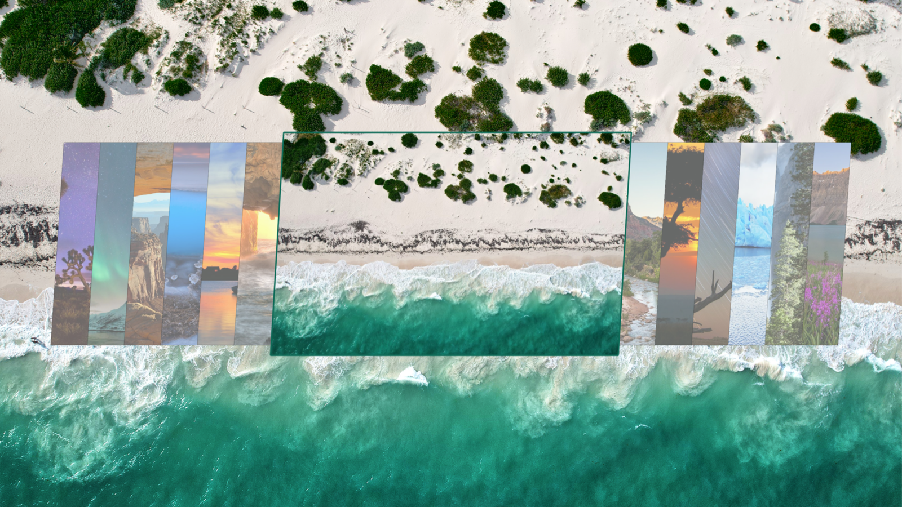

# Photo Theme

Turn photos you love into wallpapers, with desktop colors to match.



Choose a folder on your computer or in Google Drive. Pick a photo whenever you like, or let Photo Theme rotate through the collection. It uses Omarchy's familiar background picker and appears alongside your other themes.

You can use photos from any library. Export your favorites from Apple Photos, Google Photos, or Immich into your chosen folder, then let Photo Theme take it from there.

## Get started

Photo Theme works with Omarchy 4 and Python 3.11 or newer.

```bash
omarchy plugin add https://github.com/olivoil/omarchy-photo-theme --enable
```

Open **Appearance → Photo Theme → Settings** in the Omarchy menu. Choose **Install Dependencies** if any tools are missing, then set up your photos:

- **Use Local Folder** to choose a folder on your computer.
- **Connect Google Drive Folder** to paste a folder link and connect your Google account. Photo Theme only reads from Drive.

Once your photos are ready, select **Choose Photo**. Picking one applies the wallpaper and switches to Photo Theme. You can also select **Photo Theme** from Omarchy's theme picker.

iPhone and iPad photos in HEIC format are converted automatically. Your original photos stay untouched.

## Make it yours

Open **Appearance → Photo Theme**, or click its bar icon, to choose another photo and control rotation.

Under **Color Mode**, choose:

- **Auto · Match Photo** to let the photo's brightness guide the choice of light or dark colors.
- **Dark** or **Light** to keep your preferred mode while the colors follow each photo.
- **Wallpaper Only** to change photos without changing the palette.

Right-click the bar icon to switch between dark and light. If you were using Auto, choose it again from the menu when you want photos to guide the mode.

Photos rotate hourly by default. Change the interval under **Settings → Rotation Interval**, or use **Pause Rotation** to keep a favorite on screen. It stays paused until you choose **Resume Rotation**, even after a restart.

Rotation only runs while Photo Theme is selected. Switch to another Omarchy theme whenever you like.

## Add more photos

Add them to your source folder. Photo Theme checks for changes every 15 minutes; choose **Sync Photos Now** to check sooner. Downloaded photos remain available offline.

## Update or remove

Update:

```bash
omarchy plugin update io.github.olivoil.photo-theme
```

You can disable or remove Photo Theme through Omarchy's plugin menu. This stops its background work and keeps your photos and settings.

For terminal commands, requirements, or help upgrading from Personal Theme, see the [reference](docs/reference.md).

## Thanks

Photo Theme builds on [Robin Bohrer's omarchy-auto-theme](https://github.com/AccursedGalaxy/omarchy-auto-theme). [Matugen](https://github.com/InioX/matugen) creates the color palettes, and [rclone](https://rclone.org/) handles Google Drive downloads.

Photo Theme is [MIT-licensed](LICENSE). The [original integration's license](LICENSE.omarchy-auto-theme) is included; Matugen is a separate GPLv2 dependency.
